<!--
  GitHub Profile README
  Owner: Chaman Afzaal (@Chaman4211)
-->

  
  
   
  
  
  

---

## 👋 About Me

I'm **Chaman Afzaal**, a Software Engineering graduate interested in building practical AI/ML applications and reliable data systems.

I enjoy working across the data-to-intelligence workflow: collecting and preparing data, building pipelines, experimenting with machine learning, and turning ideas into usable applications.

- 🎓 BS Software Engineering — The Islamia University of Bahawalpur
- 🤖 Interested in AI/ML engineering and machine learning
- 📊 Building ETL pipelines, data cleaning workflows, and SQL-based projects
- 🧠 Exploring LLMs, Agentic RAG, and intelligent applications
- 🛠️ Learning through hands-on projects, testing, and iteration

**Current direction:** Data Engineering + AI Engineering.

## ⭐ Featured Repositories

| Project | Focus | Repository |
|---|---|---|
| **Enterprise Agentic RAG** | Document processing · RAG foundations | [Open](https://github.com/Chaman4211/enterprise-agentic-rag-system) |
| **USGS Earthquake Pipeline** | ETL · SQL · Machine Learning | [Open](https://github.com/Chaman4211/usgs-earthquake-data-pipeline) |
| **RestroMind** | Computer Vision · Table Monitoring | [Open](https://github.com/Chaman4211/RestroMind) |
| **FlyRank ML** | Machine Learning · Ranking Evaluation | [Open](https://github.com/Chaman4211/flyrank-ml-internship) |
| **Quick First Aid** | Mobile App · Firebase · AI Integrations | [Open](https://github.com/Chaman4211/Quick-First-Aid) |
| **MaternalMind AI** | AI · Wellness Application | [Open](https://github.com/Chaman4211/MaternalMind-AI) |

## 🧰 Tech Stack

**Languages**
 

**Data, AI & Machine Learning**
 

**Backend & Application Development**
 

**Developer Tools**
 

**Also working with:** Pandas · NumPy · Scikit-learn · Hugging Face · Streamlit · SQL · ETL · Data Cleaning · Feature Engineering · NLP · REST APIs · Jupyter · pytest · Postman

## 💼 Experience & Practical Learning

| Organization | Role | Period |
|---|---|---|
| Parallax Labs | AI/ML Engineer Intern | Nov 2026 – Present |
| Bigbrains | Artificial Intelligence Intern | Aug 2026 – Present |
| FlyRank AI | Machine Learning Engineering Intern | Jul – Oct 2026 |
| NIAI–NAVTTC / NETSOL | AI/ML Trainee | Sep 2026 – Present |

### Selected Work

**FlyRank AI — Content Refresh Prioritization**
- Explored search-performance data and developed preprocessing and feature-engineering workflows.
- Compared a Logistic Regression model with a rule-based baseline.
- Used client-held-out validation and ranking metrics including Average Precision and Precision@K.
- Produced ranked review recommendations intended to support human decision-making.

**Parallax Labs**
- Selected for a remote AI/ML engineering internship with structured mentorship and practical assignments.

**Bigbrains & NIAI–NAVTTC / NETSOL**
- Continuing practical learning and project work in artificial intelligence and machine learning.

## 🚀 Featured Projects

### 01 · Enterprise Agentic RAG System

Building the data foundation for an enterprise-oriented document retrieval and agentic AI system.

- Collected 6,000 arXiv records and processed 5,965 valid records.
- Built modular text preprocessing and metadata handling.
- Added dataset validation and automated tests (10 passing at the documented milestone).
- Planned next stages include semantic chunking, embeddings, ChromaDB, LangGraph, retrieval correction, and FastAPI streaming.

**Stack:** Python · Hugging Face · Pandas · PyArrow · pytest

### 02 · RestroMind — Restaurant Intelligence

A computer-vision prototype for restaurant table monitoring and cleaning-task workflows.

- Person detection and tracking.
- Configurable table zones and occupancy status.
- Cleaning alerts and staff confirmation workflow.
- Web dashboard for monitoring.

**Stack:** Python · YOLO · ByteTrack · FastAPI · React · PostgreSQL · Docker

### 03 · USGS Earthquake Data Pipeline

An end-to-end pipeline using earthquake data from the USGS feed.

- Data extraction, cleaning, transformation, and validation.
- Feature engineering and leakage-aware preprocessing.
- SQLite storage and repeatable processing.
- Classification and regression experiments.
- Automated tests and model evaluation.

**Stack:** Python · Pandas · Scikit-learn · SQLite · pytest

### 04 · FlyRank ML Internship

Machine learning work focused on search-performance analysis and content refresh prioritization.

- Exploratory data analysis and feature engineering.
- Client-held-out validation.
- Logistic Regression compared with a rule-based baseline.
- Ranking metrics and human-review recommendations.

**Stack:** Python · Pandas · Scikit-learn

### 05 · AI Powered Quick First Aid

A cross-platform mobile application concept for accessible first-aid assistance.

- Emergency SOS and emergency contacts.
- First-aid guidance and nearby facility discovery.
- AI chat and voice-assistance integrations.
- GPS-based features and medicine-scanning integration.

**Stack:** React Native · Expo · TypeScript · Firebase · AI APIs

### 06 · MaternalMind AI

An AI-assisted pregnancy wellness project.

- Pregnancy wellness and information features.
- Emotion analysis experiments.
- Tracking and supportive wellness tools.

**Stack:** Python · Streamlit · TensorFlow · PyTorch · SQLite · Docker

### 07 · LLM Chat Application

A Flutter chat application connected to a GPT-2 model through a Flask REST API.

**Stack:** Flutter · Dart · Python · Flask · GPT-2 · Hugging Face

### 08 · WorkSphere

A collaborative community project focused on multi-agent workspace discovery, recommendations, and booking.

## 📊 GitHub Analytics

  
  
   
  
   
  

## 🏆 Achievements

  

## 🐍 Contribution Snake

  <picture>
    <source media="(prefers-color-scheme: dark)" srcset="https://raw.githubusercontent.com/Chaman4211/Chaman4211/output/github-contribution-grid-snake-dark.svg"/>
    <source media="(prefers-color-scheme: light)" srcset="https://raw.githubusercontent.com/Chaman4211/Chaman4211/output/github-contribution-grid-snake.svg"/>
    
  </picture>

## 🧭 Currently Exploring

- Advanced Python and SQL
- Scalable ETL and data processing
- Apache Spark and PySpark fundamentals
- Vector databases and semantic retrieval
- Agentic RAG and LLM application patterns
- Machine learning evaluation and deployment

## 🤝 Connect

  
  

  <h3>⚡ BUILDING TODAY. ENGINEERING TOMORROW.</h3>
  
<b>Learn · Build · Experiment · Improve</b>

  

